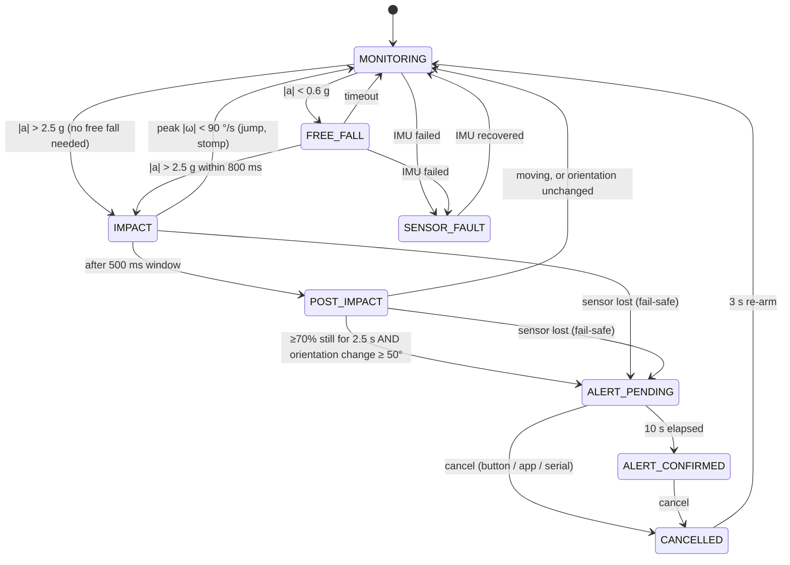

# FallGuard

**ESP32 wearable fall detector with offline local alerts and a Bluetooth companion app.**

FallGuard samples an IMU at 100 Hz, runs an explicit fall-detection state machine
(free fall → impact → rotation → post-impact inactivity + orientation change), and
alarms locally through a buzzer, LEDs and the OLED. It works with no Wi-Fi, no cloud and no
phone. A phone running the companion web app adds a remote alarm, one-tap call/SMS
to a contact, and dataset labelling.

> **Status: prototype. Detection accuracy has NOT been measured.** All thresholds are
> unvalidated starting points. See [Evaluation](#7-evaluation-protocol).

| Part | Status |
|---|---|
| ESP32 DevKit V1 + IMU (direct registers) + SH1106 OLED | Verified on hardware (V1 sketch) |
| Firmware v2 (this repo) | Flashed; boots, reads WHO_AM_I 0x70, calibrates, monitors. **Not yet stable**: on the bench the IMU bus showed intermittent read errors and a board-level USB dropout, under investigation (suspected wiring) |
| State-machine logic | 26 host-side tests pass (synthetic signals) |
| Companion app | Exercised in demo mode in a browser; **not yet tested against a real device** |
| ML classifier | Hook in firmware + feature extraction done; **no model trained yet** (needs recorded trials) |
| microSD logging | Not fitted in the current kit (`SD_ENABLED = false`); record over USB serial instead |
| Buzzer, buttons, LEDs, battery | **Untested**: wiring planned, see [docs/wiring.html](docs/wiring.html) |

---

## 1. Repository layout

```text
FallGuard/               Arduino sketch folder (open FallGuard.ino in Arduino IDE)
  FallGuard.ino          setup, 100 Hz sensor task, loop(), serial commands
  config.h               pins, IMU registers/ranges, timing, detector thresholds
  imu.h/.cpp             MPU6500-compatible register driver, calibration, fault detection
  fall_detector.h/.cpp   state machine (pure C++, also runs on a PC)
  io.h/.cpp              buttons, buzzer, LEDs (local alert, no network needed)
  display.h/.cpp         SH1106 OLED UI (U8g2, software I2C)
  logger.h/.cpp          queued CSV logging to microSD / serial
  ble.h/.cpp             BLE GATT service for the app
  status.h               shared snapshot struct
app/                     companion PWA (Web Bluetooth), no build step
test/test_fall_detector.cpp   host tests + CSV replay tool
legacy/                  put FallGuard_V1_Working.ino here (see below)
```

**Keep the V1 sketch.** Copy the last sketch that worked on the hardware to
`legacy/FallGuard_V1_Working.ino` before you flash v2, so you always have a known-good fallback.

## 2. Hardware and wiring

Full diagram with power chain and first-power-on checklist: **[docs/wiring.html](docs/wiring.html)**
(open it in a browser, or via GitHub Pages at `…/FallGuard/docs/wiring.html`).

| Function | ESP32 pin | Notes |
|---|---|---|
| IMU SDA / SCL | GPIO 21 / 22 | hardware I2C, address 0x68, VCC 3V3 |
| OLED SDA / SCL | GPIO 16 / 17 | software I2C, SH1106, address 0x3C, VCC 3V3 |
| SD CS / SCK / MISO / MOSI | GPIO 5 / 18 / 19 / 23 | *planned*; GPIO 5 is a strapping pin, so move CS to 14 if boot fails |
| Buzzer | GPIO 13 | *planned*; **passive** buzzer driven by a 2.7 kHz PWM square wave (`BUZZER_FREQ_HZ`), through an NPN transistor (e.g. 2N2222 + 1 kΩ base resistor) |
| Cancel button | GPIO 25 | *planned*; to GND, internal pull-up |
| SOS button | GPIO 26 | *planned*; to GND, internal pull-up, hold 1 s |
| Green / red LED | GPIO 32 / 33 | *planned*; with ~330 Ω series resistors |

**About the IMU:** the module is labelled MPU6050, but `WHO_AM_I` (0x75) returns **0x70**,
which is MPU6500-compatible. The Adafruit MPU6050 library refuses it, so the firmware talks
to the registers directly. The driver accepts 0x68/0x70/0x71/0x73 and writes
`ACCEL_CONFIG2` only on 6500-class chips.

**Power:** USB for now. For battery use: protected 1S LiPo → charger/protection with
load sharing → switch → 5 V boost → ESP32 VIN. Never connect a LiPo directly to VIN or 3V3.

## 3. Build and flash

**Arduino IDE 2.x**
1. Boards Manager: install **esp32 by Espressif** (tested with 3.3.8).
2. Library Manager: install **U8g2 by oliver**. Wire, SPI, SD, Preferences and BLE come with the core.
3. Open `FallGuard/FallGuard.ino`. Board: **ESP32 Dev Module**.
4. **Tools → Partition Scheme → "No OTA (2MB APP/2MB SPIFFS)"**. The default scheme
   works too, but BLE puts the build at 91% of it. No-OTA gives 57%.
5. Upload, then open the Serial Monitor at **115200** baud.

**arduino-cli**
```sh
arduino-cli lib install U8g2
arduino-cli compile --fqbn esp32:esp32:esp32:PartitionScheme=no_ota FallGuard
arduino-cli upload  --fqbn esp32:esp32:esp32:PartitionScheme=no_ota -p COM5 FallGuard
```

**Host tests** (any C++14 compiler, no hardware)
```sh
cd test
g++ -std=c++14 -I../FallGuard test_fall_detector.cpp ../FallGuard/fall_detector.cpp -o fdtest
./fdtest                # 26 scenario checks
./fdtest FG_0001.csv    # replay a recorded log through the detector
./fdtest --features a.csv b.csv > features.csv   # per-event features for ML training
```

## 4. Firmware architecture

```text
 core 1, prio 5, every 10 ms (vTaskDelayUntil)        core 1, prio 1 (Arduino loop)
 ┌───────────────────────────────────────┐         ┌──────────────────────────────┐
 │ sensorTask                            │ queue   │ loop()                       │
 │  imu.read ─► detector.update ─► Io    │────────►│  Logger::service  (SD write) │
 │  buttons / BLE / serial commands ─┘   │ samples │  Display::render  (≈ slow)   │
 │  fault detection + IMU recovery       │         │  Ble::publish, serial status │
 │  task watchdog (3 s → reboot)         │ snapshot│                              │
 │  writes `shared` under spinlock ──────┼────────►│  copies `shared`             │
 └───────────────────────────────────────┘         └──────────────────────────────┘
```

Detection and the local alarm sit in one high-priority task. Anything slow or blocking
(the bit-banged OLED, SD writes and card retries, BLE, serial) sits in `loop()`, which
that task preempts. So an OLED frame or an SD stall can never delay a sample. The two sides
share only a spinlock-protected `Status` copy and a 200-sample FreeRTOS queue (2 s of
buffering). If the queue overflows, samples are dropped *from the log only* and counted.

| Module | What it does |
|---|---|
| `imu` | Bus-clear (9 SCL pulses + STOP) → `Wire` at 100 kHz with a 50 ms timeout (400 kHz / 5 ms caused read errors and driver hangs on jumper wires) → `WHO_AM_I` check → device reset → PLL clock, ±8 g, ±1000 °/s, 41 Hz DLPF → **register readback verify**. 14-byte burst reads. Flags full-scale saturation. Detects **frozen data** (25 identical frames means the chip is asleep or stuck but still ACKing). Calibration takes 200 samples, rejects the result if the gyro standard deviation is above 1.5 °/s or \|a\| isn't ≈ 1 g, retries 3×, saves the bias to NVS, and falls back to the stored bias if the device can't be held still. |
| `fall_detector` | The state machine below. Takes `(time, sample-or-null, sensorFault, command)`, so it is deterministic and testable on a PC. |
| `io` | Debounced buttons (30 ms). SOS needs a 1 s hold. Per-state buzzer/LED patterns. A green 60 ms heartbeat blink shows the firmware is alive. |
| `display` | SH1106 via U8g2 `SW_I2C` (the verified constructor). Live screen shows state, \|a\|, \|ω\|, axes, WHO_AM_I, calibration source and alert count; separate alert, countdown and fault screens. Frame time is measured and printed. |
| `logger` | Write/read self-test on boot. New `FG_NNNN.csv` per boot with a `#` header (firmware, reset reason, thresholds). 4 KB buffer, flushed every 1 s (at most ~1 s lost on power cut). Any SD error disables logging and retries every 5 s. The rest of the system is unaffected. |
| `ble` | GATT server, 20-byte status notification at 5 Hz plus on every state change. Accepts cancel/SOS/label commands. Re-advertises after disconnect. |

### Why ±1000 °/s (changed from V1)
V1 used ±250 °/s. The ~240 °/s seen while waving the board was almost certainly the sensor
clipping, and body rotation during a fall often exceeds 250 °/s. To restore V1 behaviour, set
`IMU_GYRO_CFG = 0x00` and `IMU_GYRO_LSB_PER_DPS = 131.0f` in `config.h`.

## 5. Fall-detection state machine



Plus: **SOS (1 s hold, app or `sos`) jumps from any state to ALERT_CONFIRMED**, including
SENSOR_FAULT. Manual help requests never depend on the sensor.

Features used:
* **Impact**: peak \|a\|. Not every real fall has a clean free-fall phase, so a direct impact path exists.
* **Rotation**: peak \|ω\| from the start of free fall to the end of the impact window. Rejects jumps and stomps.
* **Inactivity**: share of samples with \|\|a\| − 1 g\| ≤ 0.3 g and \|ω\| ≤ 40 °/s, measured 1–3.5 s after impact.
* **Orientation change**: angle between the gravity vector low-passed before the event and the mean
  accel vector during the stillness window. This separates "fell and is lying down" from "sat down hard".

All thresholds live in `config.h` (`DET_*`) and in `DetectorConfig`, so the replay tool can
sweep them without reflashing. **They are guesses for waist/chest placement until you measure them.**

### Failure handling

| Failure | Detected by | Response |
|---|---|---|
| IMU unplugged / bus error | 5 consecutive failed reads (50 ms) | SENSOR_FAULT: red blink, chirp every 10 s, OLED/app warning; re-init every 500 ms |
| SDA held low by a confused slave | Re-init path | 9-clock bus clear + STOP before `Wire.begin` |
| IMU reset/brownout (wakes in sleep, still ACKs) | Config readback every 1 s; frozen-frame detector | SENSOR_FAULT → re-init |
| IMU lost right after an impact | State machine | ALERT_PENDING (fail-safe, wearer can cancel) |
| Device moved during calibration | Std-dev / \|a\| checks | Retry ×3 → NVS bias → "UNCAL" shown |
| Sensor task hangs | Task watchdog, 3 s | Reboot; reset reason shown on OLED and in log header |
| SD missing / write error | `SD.begin`, self-test, short writes | Logging off, retried every 5 s, detection unaffected |
| SD stall > 2 s | Queue full | Samples dropped from the log only (`drop=` counter) |
| Phone disconnects / out of range | App | App alarms "Connection lost" and auto-reconnects with backoff; device alarms locally regardless |
| App gets no packets for 3 s | App watchdog | "No data from device" |

## 6. Companion app (`app/`)

A no-build Progressive Web App that uses **Web Bluetooth**. Nothing to install from a store,
no server, no account, and it works offline once loaded.

* **Live view**: state, \|a\|, \|ω\|, sensor/calibration/SD flags, 30 s acceleration chart.
* **Alerts**: full-screen countdown with an "I'm OK" cancel. On confirmation: loud alarm,
  vibration, system notification, and one-tap **Call** / **SMS** to the saved contact, with GPS location in the SMS if allowed.
* **Hold-to-SOS** button (1.5 s), event log with CSV export, keep-screen-on toggle.
* **Dataset labelling**: one tap sets the `label` column in the device's log during trials.

### Using the app, step by step

**App link:** https://victor-vit-projects.github.io/FallGuard/app/
**Try it without hardware:** https://victor-vit-projects.github.io/FallGuard/app/?demo (simulated device that "falls" every 20 s)

**One-time setup (Android phone)**
1. Turn on **Bluetooth** and **Location** (Android needs Location on for any Bluetooth scan).
2. Open the app link in **Chrome**.
3. Chrome menu (⋮) → **Add to Home screen**. It now opens like a normal app and works offline.
4. Open **Emergency contact**, enter a name and phone number. It is stored only on this phone.
5. Tap **Test alarm sound** once; this also unlocks audio, which browsers block until you tap.
6. Allow **notifications** when asked.

**Every time**
1. Power the FallGuard device and wait for **MONITORING** on the OLED.
2. In the app tap **Connect device** → pick **FallGuard** from the list → **Pair**.
3. The pill at the top turns green (*Connected*), live |a| and |ω| values update 5×/s, and
   a **B** appears at the top-right of the OLED.
4. Keep the app open (tap **Keep screen on** if needed). If the phone walks out of range it
   alarms "Connection lost" and reconnects by itself when back in range.

**What happens in a fall**
| Device | App |
|---|---|
| ALERT_PENDING: 10 s countdown, beeps, red LED | Orange full-screen countdown with **I'm OK, cancel** |
| Cancel button pressed (device or app) | Overlay closes, back to monitoring after 3 s |
| No cancel → ALERT_CONFIRMED, continuous alarm | Red screen, loud alarm, vibration, notification, **Call** / **SMS** buttons for your contact (SMS includes GPS location if allowed) |

**Other controls**: hold **Hold for SOS** for 1.5 s to raise an alert from the phone; the
**Dataset label** chips tag the device's CSV log during data-collection trials; **Event log**
keeps a history you can export as CSV.

**Run it locally instead** (laptop with Chrome): `cd app && python -m http.server 8000`,
then open `http://localhost:8000`. Web Bluetooth only works on HTTPS or localhost.

**Browsers**: Chrome/Edge on Android, Windows, macOS and ChromeOS. Not Firefox. Not iOS Safari
(use the Bluefy browser on iPhone).

**Troubleshooting**
* *FallGuard not in the list*: device not powered/booted, Location off, or another phone is already connected (BLE allows one).
* *"Web Bluetooth isn't available"*: wrong browser, or the page was opened over plain `http://` from another machine.
* *Connected but values frozen, pill says "No data from device"*: the device rebooted or hung; check the OLED / serial log.

### BLE protocol

Service `fa110001-7c4e-4b8a-9e2f-3d6a5b1c0e01`

| Characteristic | UUID | Properties | Format |
|---|---|---|---|
| Status | `fa110002-…` | read, notify | 20 bytes, little-endian (below) |
| Command | `fa110003-…` | write | `01` cancel · `02` SOS · `03 <ASCII ≤19>` set label |

| Offset | Type | Field |
|---|---|---|
| 0 | u8 | version (1) |
| 1 | u8 | state (0 MONITORING … 7 SENSOR_FAULT, order as in `FallState`) |
| 2 | u8 | flags: b0 IMU OK, b1 SD OK, b2 calibrated, b3 saturated, b4–5 reason (0 none, 1 fall, 2 SOS, 3 sensor lost) |
| 3 | u8 | cancel countdown, seconds |
| 4 | u16 | \|a\| mg |
| 6 | u16 | \|ω\| °/s |
| 8 / 10 | u16 | last event peak \|a\| mg / peak \|ω\| °/s |
| 12 / 13 | u8 | last event still % / orientation change ° |
| 14 | u16 | alerts since boot |
| 16 | u32 | uptime ms |

## 7. Testing procedures

Record pass/fail and the serial output for each step.

| # | Test | Procedure | Pass criteria |
|---|---|---|---|
| T0 | Logic | `./fdtest` | `ALL PASSED` |
| T1 | Boot | Flash, open serial at 115200 | `WHO_AM_I=0x70`, bias printed with `(fresh)`, OLED shows MONITORING |
| T2 | Calibration reject | Shake the board during CALIBRATING | "device moved", retries; after 3 failures "from NVS" |
| T3 | Live values | Flat on table, then rotate | \|a\| ≈ 1.00 g still; \|ω\| < 2 °/s still, reacts to rotation |
| T4 | Timing | Watch `[STAT]` for 5 min while connected to the app | `miss=0` (or near), `drop=0`; note `oled=` ms |
| T5 | I2C fault | Pull the IMU SDA wire while running | SENSOR_FAULT within ~0.1 s, red blink, app shows IMU FAULT |
| T6 | Recovery | Reconnect SDA | Back to MONITORING within ~1 s, with no reboot |
| T7 | Watchdog | (optional) add `while(1);` in sensorTask temporarily | Reboot after 3 s, `last reset: TASK_WDT` |
| T8 | Alert flow | Serial `sos`, then `c` | ALERT_CONFIRMED, then CANCELLED → MONITORING after 3 s |
| T9 | Cancel window | Trigger a simulated fall (T13), don't cancel | ALERT_PENDING counts 10 → 0 → ALERT_CONFIRMED |
| T10 | Buttons/buzzer | Tap cancel during pending; hold SOS 1 s; short SOS tap | Cancels; SOS confirms; a short tap does nothing |
| T11 | SD | Card in → boot; then pull the card while running; reinsert | `logging to /FG_0001.csv`; error + "retry"; new file after reinsert; detection never stops |
| T12 | App | Connect, walk out of range, return | "Connection lost" alarm, then auto-reconnect |
| T13 | Simulated fall | Wear at the waist, kneel, and lower yourself onto a mattress onto your side; lie still 4 s | ALERT_PENDING (record whether it fires; this is data, not a guaranteed pass) |

**Safety:** never do real falls. Use a crash mat or mattress, and do controlled lowering or
dropping the device itself, with a spotter.

## 8. Evaluation protocol

1. **Record.** For each activity (walking, sitting, standing up, stairs, jumping, arm swings,
   simulated falls, device drop, device removed) set the label in the app or with serial
   `l walking`, then perform N trials. Use the SD log, or capture serial after sending `s`
   (stream mode; every non-CSV line starts with `#`, so `pandas.read_csv(f, comment='#')` works).
2. **Split.** Pick participants/sessions for *tuning* and different ones for *evaluation*
   *before* looking at results. Tune thresholds only on the tuning set (`./fdtest file.csv`
   shows the features for every event).
3. **Score on the evaluation set only.**
   * Sensitivity = detected falls / simulated falls
   * Specificity per activity = trials without an alert / trials
   * False alarms per hour of normal wear
4. **Report honestly**: number of trials and participants, placement, and that these were
   simulated falls by young adults. Results on that do not transfer to elderly real falls.

## 9. Serial interface (115200 baud)

| Command | Effect |
|---|---|
| `c` | cancel alert |
| `sos` | manual SOS |
| `s` | toggle 100 Hz CSV stream (same columns as the SD log) |
| `l <label>` | set dataset label |

Diagnostics: `# [STAT]` every second (state, \|a\|, \|ω\|, IMU status, error/saturation/missed-tick
counters, log drops, SD file, BLE, OLED frame time) and `# [EVENT]` on state changes with the event features.

CSV columns: `timestamp_ms,ax_g,ay_g,az_g,gx_dps,gy_dps,gz_dps,accel_mag_g,gyro_mag_dps,state,label`

## 10. Known limitations

* **No measured accuracy.** Thresholds are unvalidated. Results so far come only from synthetic test signals.
* Firmware v2, the app↔device BLE link, SD logging, buzzer, buttons and LEDs are **untested on hardware**.
* Placement is assumed to be waist/chest. A wrist-worn device would need different features and thresholds.
* A dropped device can look like a fall (free fall + impact + still + orientation change).
  It is mitigated only by the cancel window.
* The IMU is polled at 100 Hz (INT pin not connected), so sample timing has ~1 ms jitter.
  Timestamps are recorded per sample.
* An alert active during an unexpected reboot is not restored. The reset reason is logged
  and shown on boot.
* BLE has no pairing or encryption: anyone within range can connect, cancel an alert or trigger SOS.
* The app only works while it's open (or in the foreground on Android). It cannot send SMS
  on its own; it prepares the message for one tap. A native app would be needed for
  background monitoring and automatic SMS.
* The software-I2C OLED is slow (see `oled=` in `[STAT]`). It doesn't affect sampling. To speed it
  up, move it to the second hardware I2C controller (`U8G2_SH1106_128X64_NONAME_F_2ND_HW_I2C`, same pins).
* No battery monitoring yet.
